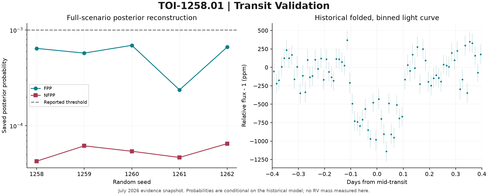

# TOI-1258.01 | Transit Validation

**Statistical-validation evidence; not a mass measurement or dynamical confirmation.**

A transparent transit-validation evidence package for TIC 288132261. It connects TESS photometry, centroid diagnostics, contrast curves, and TRICERATOPS scenario probabilities without treating statistical validation as a mass measurement.

> **Corrected rerun (2026-10-25):** the historical TRICERATOPS probabilities are
> superseded. The historical contrast curves were corrupted, and the
> TRICERATOPS module predated the upstream 2026 fixes. With current TRICERATOPS
> and corrected inputs, FPP < 5×10⁻⁶ and NFPP ≈ 10⁻¹⁵. See the
> [corrected rerun](rerun/README.md).



*Generated from the bundled historical measurements. This is a scientific
diagnostic, not an image or confirmation of a newly discovered object.*

## Exact Inputs and Reruns

See the [FITS/calibration reproduction guide](docs/RAW_REPRODUCTION.md) for
checksummed archive inputs, historical software, executable commands and tested
coverage. Large preserved inputs live in the private data release, not Git history.

## Start Here

| Question | Resource |
| --- | --- |
| What can the evidence support? | [Scientific status](docs/SCIENCE.md) |
| How do I run it? | [Reproduction guide](docs/REPRODUCING.md) |
| Where did these data come from? | [Data and units](docs/DATA.md) |
| What does a completed run produce? | [Example result](examples/summary.json) |
| Can I inspect the original methods? | [Historical source](research/README.md) |

## Run the Audit

Python 3.11+; run from this repository's root:

```shell
python -m pip install -e .
python -m toi1258
python -m unittest discover -s tests -v
```

The supported audit is offline and uses only Python's standard library. It
verifies SHA-256 checksums before calculating results and writes JSON, CSV and
Markdown under `results/`. For an isolated setup, use the virtual-environment
instructions in the reproduction guide.

## Scope

- Real saved measurements and explicit original/export hashes.
- Tested arithmetic, record matching, and interpretation limits.
- Reproducible figure generation and Windows/Linux CI configuration.
- No embedded credentials, raw archive downloads, or journal correspondence.
- Documented core FITS reruns; no automatic physical classification.

Historical evidence snapshot: **2026-07-14**. Repository packaging: **2026-10-25**.
Current catalog status and literature novelty are not inferred from that date.

## Project Layout

The expanded [source inventory](research/SOURCE_INVENTORY.json) records every
included project script, shared library, distinct historical version, and
manuscript source with original/export hashes. Historical code is under
`research/workspace/`; manuscript material is under [papers](papers/README.md).
Read the reproduction coverage and inventory exclusions before assuming every
exploratory pipeline has been rerun. PHAT source recovery is documented separately.

```text
src/          Supported offline audit package
data/         Curated historical tables and provenance manifest
docs/         Scientific status, data guide, reproduction instructions
research/     Historical source for inspection; external inputs required
tests/        Regression, integrity, and failure-case tests
tools/        Figure generation and repository hygiene checks
examples/     Regenerated reference output
figures/      Evidence overview
.github/      CI and contribution templates
```

## Citation and Use

Author: **Nikolai Klaus Stoloff**. See [CITATION.cff](CITATION.cff).
Cite the original archives and methods separately. This repository is not a
claim of peer review, acceptance, confirmed discovery, or priority.

[Contributing](CONTRIBUTING.md) · [Security](SECURITY.md) ·
[Changelog](CHANGELOG.md) · [Licensing pending](LICENSE_NOTICE.md)

